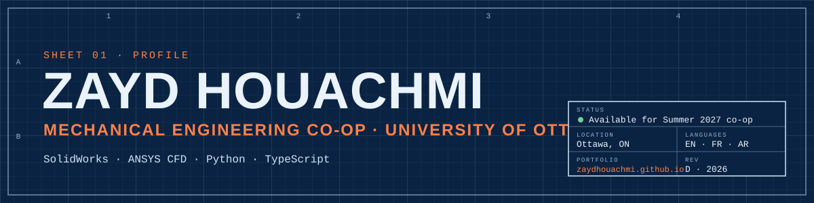

I'm a mechanical engineering co-op student at the University of Ottawa. I design parts in SolidWorks, test them in ANSYS CFD and on track with the Formula SAE aero team, and write software when the engineering needs it, from a wind-farm energy model to a voice interface for government forms.

**Looking for a Summer 2027 co-op** in mechanical design, aerodynamics, energy or renewables.

[Portfolio](https://zaydhouachmi.github.io) · [Résumé (PDF)](https://zaydhouachmi.github.io/assets/Mohamed-Zayed-Houachmi-Resume.pdf) · [LinkedIn](https://www.linkedin.com/in/zayd-houachmi-b5578735a/) · [Email](mailto:mozaydhouachmi@gmail.com)

## Code

| Project | What it is | Built with |
|---|---|---|
| **[SpeakGov](https://github.com/ZaydHouachmi/ottawa-voice)** · [live](https://speakgov.com) | Fill in a government benefit form by talking, in English or French, without needing to read it. Built solo at Hack the Hill III (uOttawa, Sept 2026). | Next.js, TypeScript, Gemini, ElevenLabs, Web Speech API, Auth0 |
| **[Wind Farm Energy Assessment](https://github.com/ZaydHouachmi/wind-farm-energy-assessment)** · [case study](https://zaydhouachmi.github.io/work/wind-farm.html) | Annual energy production for a wind farm: Weibull wind resource, Jensen and Ainslie wake models, six-factor loss cascade. Built during my internship at Greenard Consulting and validated against WAsP. | Python, NumPy, SciPy, Streamlit, pytest |
| **[Tutoring Ottawa](https://github.com/ZaydHouachmi/tutoring-platform)** · [live](https://tutoring-platform-mauve.vercel.app) | Bilingual booking site for my tutoring business. Server-side validation, rate limiting, honeypot, and a Postgres table locked down with row-level security. | Next.js, TypeScript, Supabase, Vitest, GitHub Actions |
| **[Portfolio](https://github.com/ZaydHouachmi/zaydhouachmi.github.io)** · [live](https://zaydhouachmi.github.io) | My engineering portfolio, styled as a drawing set, with a live Jensen wake model you can play with. | HTML, CSS, JavaScript (no framework) |

## Engineering

These live on my portfolio rather than in code:

- **[Formula SAE wings](https://zaydhouachmi.github.io/work/formula-sae.html):** front and rear wings in SolidWorks, full-car ANSYS CFD at CL −1.91 (320 N at 65 km/h), validated on track within 10%, built in carbon fibre.
- **[Clip-on visual shield](https://zaydhouachmi.github.io/work/visual-shield.html):** my design and SolidWorks model of a foldable shield that blocks peripheral distractions for a student client.
- **[ZEIKU swab dryer](https://zaydhouachmi.github.io/work/zeiku.html):** team lead on a contamination-free DNA swab dryer for the Ottawa Police Service.

## Toolbox

- **Engineering:** SolidWorks · ANSYS CFD · WAsP · Arduino · composite layup · 3D printing · laser cutting
- **Code:** Python (NumPy, Streamlit) · TypeScript · Next.js · React · C · C++ · C# · SQL (Postgres)
- **Languages:** English · French (DELF) · Arabic
